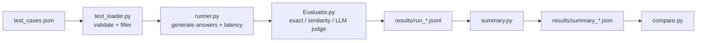

# LLM Eval Harness

A lightweight, command-line harness for evaluating LLM outputs against a set of test cases. It generates answers with a configurable model, scores each answer with three different metrics, and writes per-case results plus an aggregated summary. Two summaries from different runs can then be compared side by side to catch regressions.

Any provider with an OpenAI-compatible API works (Gemini, OpenRouter, Hugging Face router, etc.).

## Features

- **Interactive test selection**: choose which difficulty levels and question types to run.
- **Schema validation**: test cases are validated with Pydantic before running; invalid cases are reported and skipped.
- **Config-driven models**: providers and model names live in `llm_config.toml`.
- **Three scoring methods** per answer: exact match, semantic similarity, and LLM-as-judge.
- **Latency tracking** for every generation call.
- **Aggregated summary** by tag, by difficulty, and overall, plus mean and p95 latency.
- **Run comparison** between a baseline summary and a new summary.

## How it works



1. **Load and filter**: `main.py` asks for the path to a test-case file. `test_loader.py` validates every case and then asks which difficulty levels and tags to include.
2. **Generate**: `runner.py` sends each selected case to the active model with a system prompt and requests a JSON reply of the form `{"answer": "..."}`. Cases tagged `summarization` use a summarization prompt; everything else uses a question-answering prompt. Latency is measured per call.
3. **Score**: `Evaluator.py` scores each answer against the expected answer (see [Metrics](#metrics)).
4. **Save**: every scored case is appended to `results/run_<timestamp>.jsonl`.
5. **Summarize**: `summary.py` aggregates the run into `results/summary_<timestamp>.json`.
6. **Compare** (optional): `compare.py` prints a table comparing two summary files.

## Project structure

```
.
├── main.py             # Entry point: orchestrates the whole pipeline
├── test_loader.py      # Pydantic validation + interactive difficulty/tag filtering
├── runner.py           # Calls the LLM to generate answers, measures latency
├── Evaluator.py        # Exact match, semantic similarity, LLM-as-judge
├── summary.py          # Aggregates a run into a summary JSON
├── compare.py          # Compares two summary files (baseline vs new)
├── llm_config.toml     # Model/provider configuration
└── cases/
    └── test_cases.json # Sample test cases
```

`results/` is created at runtime and is git-ignored.

## Requirements

- Python **3.12+**
- An API key for at least one provider configured in `llm_config.toml`

Python packages used:

```
openai
python-dotenv
rich
questionary
pydantic
pandas
numpy
sentence-transformers
```

## Setup

```bash
git clone https://github.com/satyam-sharma7/Project_5_LLM_Eval_Harness.git
cd Project_5_LLM_Eval_Harness

python -m venv .venv
source .venv/bin/activate        # Windows: .venv\Scripts\activate

pip install openai python-dotenv rich questionary pydantic pandas numpy sentence-transformers

mkdir results                    # output folder for runs and summaries
```

Create a `.env` file in the project root with the key for the model you plan to use:

```env
GOOGLE_AI_STUDIO=your_key_here
# or
OPENROUTER_API_KEY=your_key_here
# or
HF_TOKEN=your_key_here
HF_TOKEN_2=your_key_here
```

The first run downloads the `all-MiniLM-L6-v2` sentence-transformers model, so it needs an internet connection and may take a moment.

## Configuration

Models are defined in `llm_config.toml`:

| Key        | Provider   | Model                                    | Env variable        |
|------------|------------|------------------------------------------|---------------------|
| `minmax`   | OpenRouter | `minimax/minimax-m2.5:free`              | `OPENROUTER_API_KEY` |
| `gemini`   | Google AI Studio | `gemini-3-flash-preview`           | `GOOGLE_AI_STUDIO`  |
| `glm`      | Hugging Face router | `zai-org/GLM-5.1:fireworks-ai`  | `HF_TOKEN`          |
| `qwen`     | Hugging Face router | `Qwen/Qwen3.6-35B-A3B:featherless-ai` | `HF_TOKEN_2`  |

Each entry has `provider`, `url`, `api` (name of the env variable holding the key), `name` (model ID), `temperature`, and `max_tokens`.

**Switching the active model:** set `ACTIVE_MODEL` at the top of both `runner.py` (generation) and `Evaluator.py` (LLM judge) to one of the keys above (e.g. `"gemini"`).

**Adding a model:** add a new `[models.<key>]` block with the fields above, then point `ACTIVE_MODEL` to it. Any OpenAI-compatible endpoint works.

## Test case format

Test cases are a JSON array. Each case is validated against this schema:

```json
{
  "id": "q_001",
  "input": "What is the capital of France?",
  "expected": "Paris",
  "tags": ["factual", "geography"],
  "difficulty": "easy"
}
```

| Field        | Type            | Rules                                                              |
|--------------|-----------------|--------------------------------------------------------------------|
| `id`         | string          | Unique identifier                                                  |
| `input`      | string          | The question or text sent to the model                             |
| `expected`   | string          | Reference answer                                                   |
| `tags`       | list of strings | 1 to 2 tags from: `factual`, `geography`, `summarization`, `reasoning`, `math` |
| `difficulty` | string          | One of `easy`, `medium`, `hard`                                    |

A case is included in a run if its difficulty is among the selected levels **and** at least one of its tags is among the selected tags.

## Usage

### Run an evaluation

```bash
python main.py
```

You will be prompted to:

1. Enter the path to your test-case file (e.g. `cases/test_cases.json`).
2. Select difficulty levels (Easy / Medium / Hard).
3. Select question types (Factual / Geography / Summarization / Reasoning / Math).

The tool then validates the cases, generates answers, scores them, and saves the results.

### Compare two runs

```bash
python compare.py --baseline results/summary_<old>.json --new results/summary_<new>.json
```

This prints a table with the overall semantic average, pass rate, and p95 latency for both runs.

## Output

### Per-case results: `results/run_<timestamp>.jsonl`

One JSON object per line:

```json
{
  "input": "What is the capital of France?",
  "expected": "Paris",
  "actual": "Paris",
  "tags": ["factual", "geography"],
  "difficulty": "easy",
  "latency_ms": 812.4,
  "exact_match_score": 1,
  "similarity_score": 1.0,
  "llm_score": 1.0
}
```

### Summary: `results/summary_<timestamp>.json`

```json
{
  "overall":       { "semantic_avg": 0.87, "pass_rate": "..." },
  "by_tag":        { "factual": 0.95, "math": 0.60 },
  "by_difficulty": { "easy": 0.98, "medium": 0.74 },
  "latency":       { "mean_ms": 910.2, "p95_ms": 1480.7 }
}
```

`semantic_avg`, `by_tag`, and `by_difficulty` are averages of the LLM-judge score. Because a case can carry two tags, it counts toward both tags' averages.

## Metrics

| Metric | Range | What it measures |
|--------|-------|------------------|
| **Exact match** | 0 or 1 | Case-insensitive, whitespace-trimmed string equality between expected and actual. Strict; good for short factual answers. |
| **Semantic similarity** | -1 to 1 (typically 0 to 1) | Cosine similarity between `all-MiniLM-L6-v2` sentence embeddings. Rewards answers with the same meaning but different wording. |
| **LLM judge** | 0 to 1 | A model is given the expected and actual answers and returns a score for how closely their meanings match (0 = unrelated, 0.5 = partially similar, 1 = same meaning). |

## Known limitations

- `pass_rate` in the summary is currently a placeholder and is not yet computed from the scores.
- `compare.py` depends on `pass_rate` being numeric, so it needs that value fixed before comparisons work.
- The LLM judge uses the same model as the generator, which can bias scores in the model's favour.
- `temperature` and `max_tokens` in `llm_config.toml` are not yet passed to the API calls.
- Exact match and similarity scores are saved per case but are not included in the summary.
- The `results/` folder must exist before the first run.

## Roadmap

- Compute a real pass rate with a configurable threshold
- Use a separate judge model
- Select the model via a CLI flag instead of editing code
- Include exact-match and similarity metrics in the summary and comparison
- Larger, more varied test-case sets

## License

No license has been specified yet.
